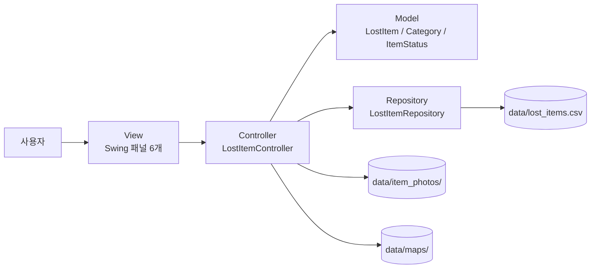
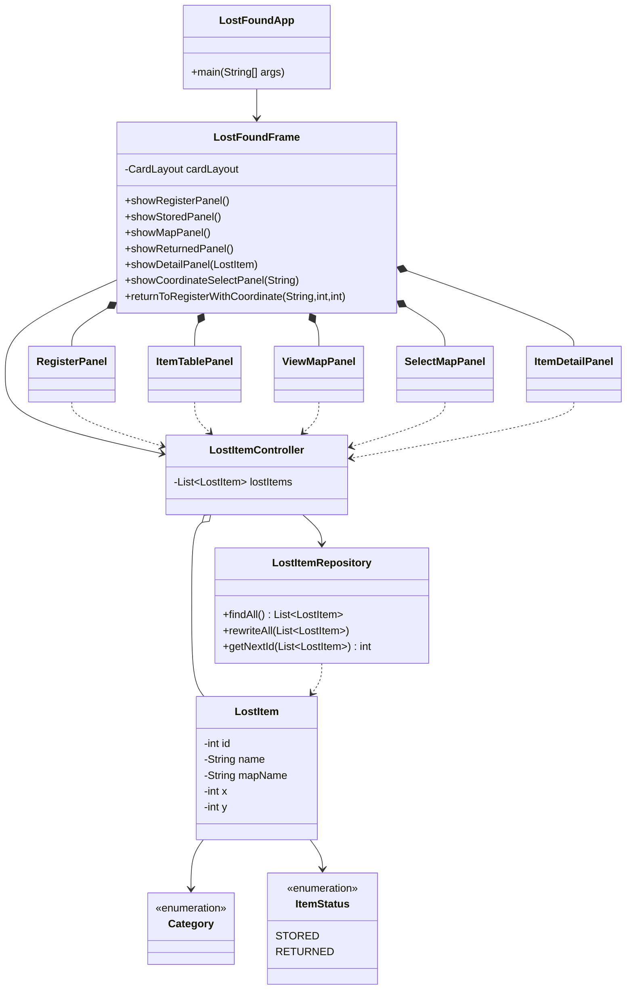
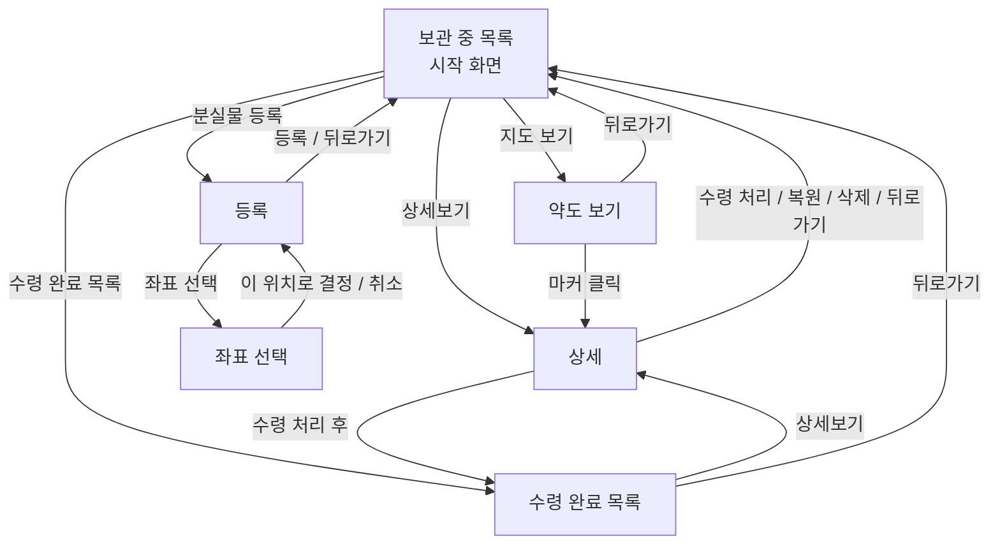

# 시스템 설계 문서

## 1. 시스템 아키텍처

- 구조: MVC + Repository 계층
- View는 Controller만 호출하고, Controller는 Repository를 통해 파일에 접근
- 프레임(`LostFoundFrame`)이 화면 전환을 전담하여 패널끼리 서로 참조하지 않음

| 계층 | 역할 |
|---|---|
| View | 화면 출력, 사용자 입력, 입력값 검증 |
| Controller | 등록/검색/수령/삭제 로직, 사진 복사·삭제, 메모리 목록 관리 |
| Repository | CSV 읽기/쓰기 (변경 시 전체 파일 재작성) |
| Model | 분실물 데이터와 enum |

## 2. 클래스 다이어그램

## 3. 화면 흐름도

## 4. 데이터 명세 (`data/lost_items.csv`)

| 컬럼 | 타입 | 설명 |
|---|---|---|
| id | int | 고유 번호 (마지막 id + 1로 자동 생성) |
| name | String | 물건명 |
| category | enum | 전자기기, 카드, 지갑, 도서, 학용품, 가방, 의류, 악세서리, 생활용품, 기타 |
| mapName | String | 습득 층 (`data/maps/`의 이미지 파일명) |
| registeredDate | String | 등록 일시 (`yyyy-MM-dd HH:mm`, 자동) |
| description | String | 비고 |
| imagePath | String | 사진 경로 (`data/item_photos/...`), 없으면 빈 값 |
| x, y | int | 약도 위 좌표, 미선택 시 -1 |
| status | enum | `STORED`(보관 중), `RETURNED`(수령 완료) |
| receiverName | String | 수령자 이름 (수령 시 입력) |
| receiverContact | String | 수령자 연락처 (`010-0000-0000` 형식) |
| returnedDate | String | 수령 일시 (자동) |

## 5. Controller 메서드 명세

| 메서드 | 입력 | 반환 | 동작 |
|---|---|---|---|
| `getStoredItems()` | - | List | 보관 중 목록 |
| `getReturnedItems()` | - | List | 수령 완료 목록 |
| `addItem(item, sourceImagePath)` | 분실물, 원본 사진 경로 | - (IOException) | 사진 복사, id·등록일 부여, CSV 저장 |
| `searchStoredItems(keyword)` | 검색어 | List | 보관 중 목록에서 검색 |
| `searchReturnedItems(keyword)` | 검색어 | List | 수령 완료 목록에서 검색 |
| `returnItem(id, name, contact)` | id, 수령자 정보 | - | 수령 완료 처리, 수령일 자동 기록 |
| `updateStatus(id, status)` | id, 상태 | - | 상태 변경 (보관 중으로 복원 시 수령 정보 초기화) |
| `deleteItem(id)` | id | - | 항목과 사진 파일 삭제 |
| `clearReturnedItems()` | - | - | 수령 완료 항목 전체 삭제 |
| `getItemsByMapName(mapName)` | 층 이름 | List | 해당 층 분실물 목록 |
| `getMapNames()` | - | List | `data/maps/`의 약도 이름 목록 |
| `getMapFile(mapName)` | 층 이름 | File | 약도 이미지 파일 |

- 검색 대상: id, 물건명, 비고, 분류, 층, 등록일, 수령자 이름·연락처, 수령일

## 6. 제한 사항

- 물건명과 비고에 쉼표(,) 입력 불가 (CSV 구분자 충돌)
- 비고에 줄바꿈을 입력하면 CSV 행이 깨질 수 있음 (별도 처리 없음)
- 단일 사용자 전용, 관리자/사용자 권한 구분 없음
- 실행 위치 기준 상대경로로 `data/`를 읽으므로 프로젝트 루트에서 실행해야 함
- 수령자 연락처가 평문으로 저장됨
